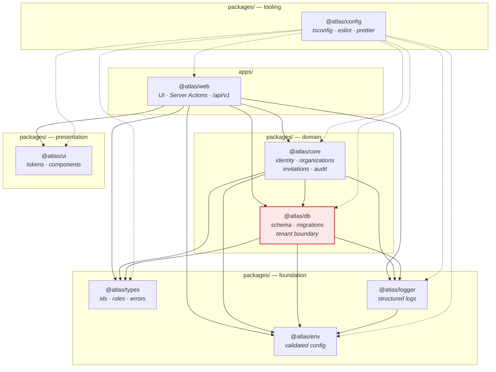
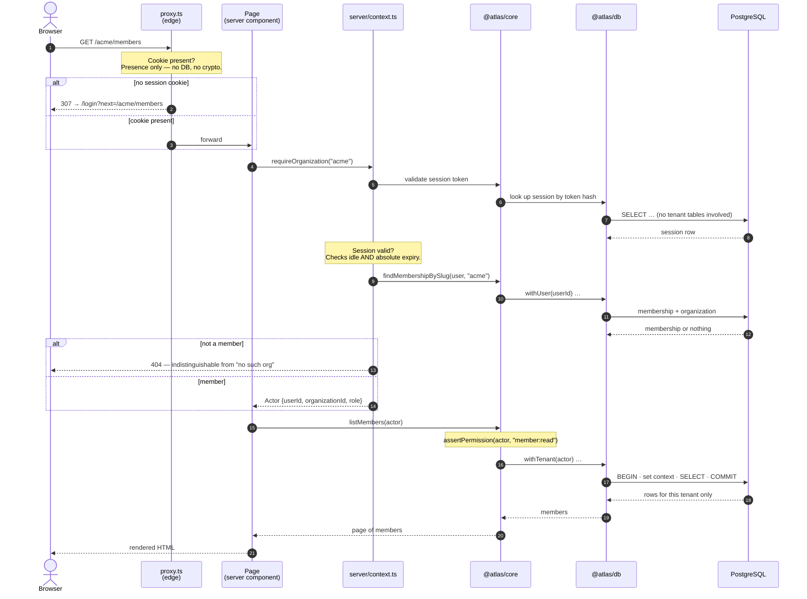
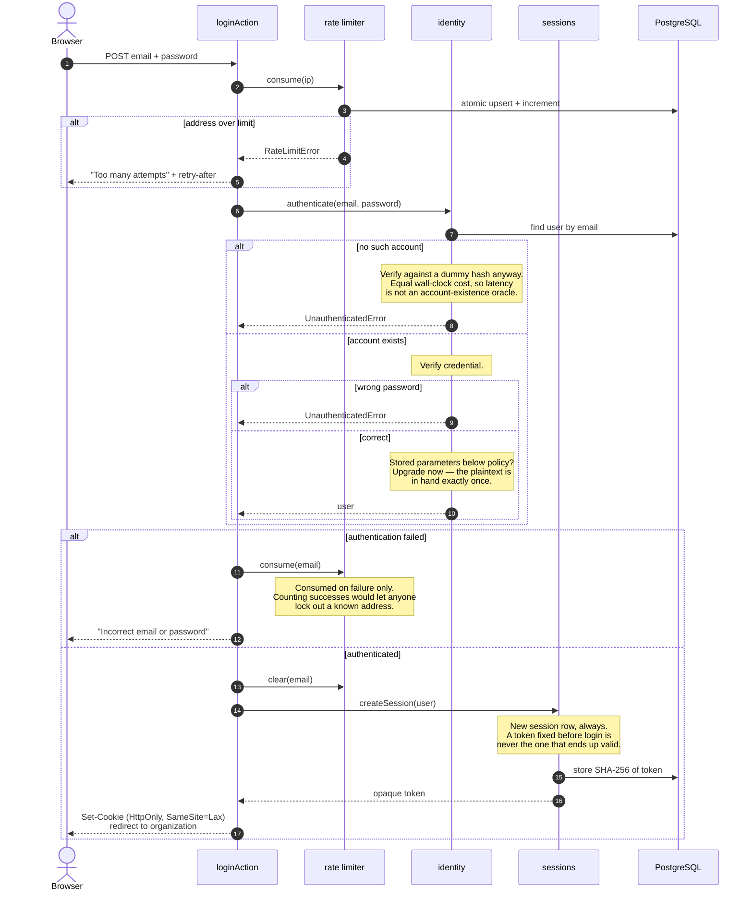
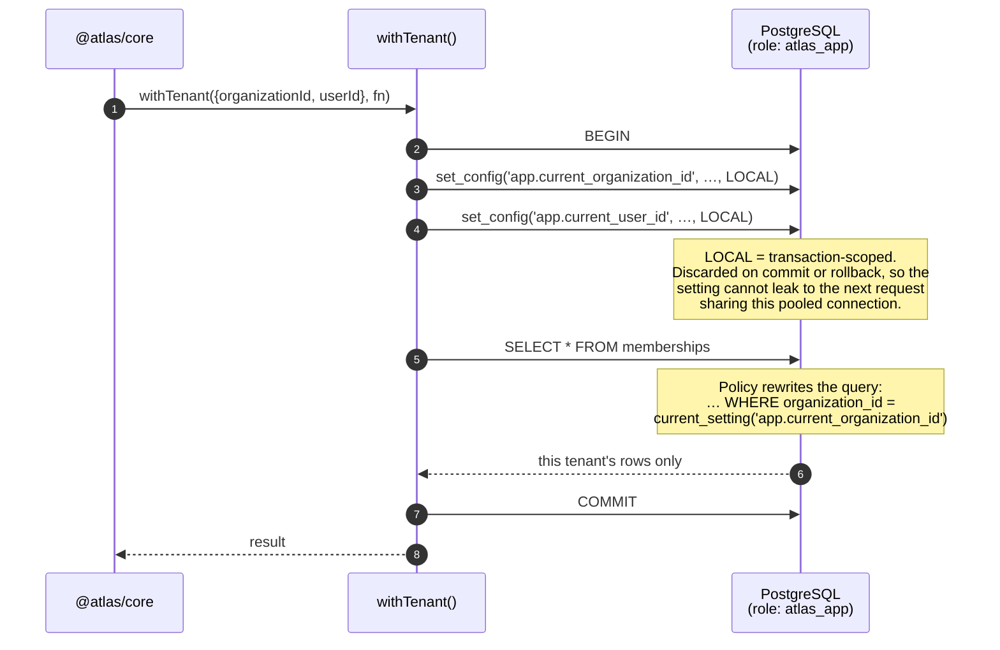
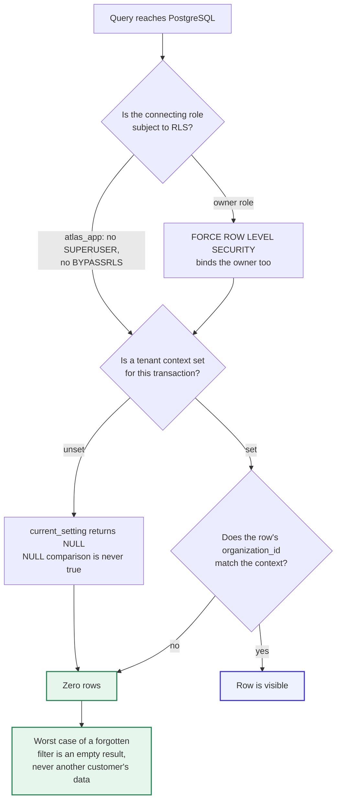
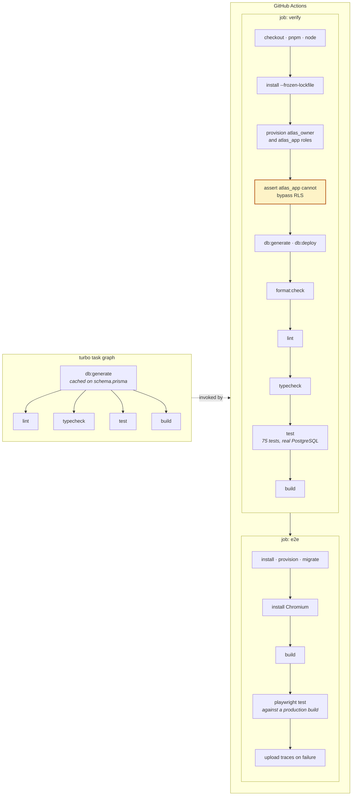

# Architecture diagrams

Five views of Atlas. Each one exists to make a specific mechanism legible, not to restate the
directory tree.

The dependency edges below are derived from the workspace manifests, and the pipeline from
`.github/workflows/ci.yml` and `turbo.json`. When those change, change these.

---

## 1. Package dependency graph

Solid edges are runtime dependencies. Dotted edges are tooling only — `@atlas/config` supplies
TypeScript, ESLint, and Prettier presets, and ships no runtime code.

**What to notice.** The graph is acyclic and points one way. `@atlas/types`, `@atlas/env`, and
`@atlas/ui` are leaves with no internal runtime dependencies, which is what makes them safe to
import from anywhere including the browser. No package depends on `@atlas/web` — that edge is
rejected by an ESLint rule in `@atlas/config`, so the direction is enforced rather than merely
documented.

`@atlas/db` is highlighted because it is the tenant boundary. Every path from the app to customer
data passes through it.

---

## 2. Request lifecycle

An authenticated page request. The same shape holds for a REST call; only the error rendering
differs.

**What to notice.** Authorization happens twice, deliberately, at two different levels.
`assertPermission` decides whether this _role_ may perform this _operation_. Row-level security
decides which _rows_ exist at all. Neither substitutes for the other: permissions without RLS leak
across tenants on a missing filter; RLS without permissions lets any member delete anything inside
their own tenant.

Note also that the role is read on every request rather than cached in the session. Revoking
someone's access takes effect on their next request, not whenever their session happens to expire.

---

## 3. Authentication flow

Login, including both failure branches. Signup follows the same shape with a per-address limit and
no credential check.

**What to notice.** Both failure messages are identical, and both cost the same time. The cookie
carries an opaque token and nothing else — no user id, no role, no organization. Anything placed in
a cookie is attacker-controlled input on the next request, so every attribute of the session is read
from the database where the client cannot edit it.

---

## 4. Tenant isolation flow

The mechanism that makes shared-schema multi-tenancy safe.

And the property that matters — what happens when the context is missing or wrong:

**What to notice.** The design fails closed. An unscoped connection sees nothing rather than
everything, which inverts the usual risk: the bug you ship is a visible empty screen, not a silent
cross-tenant leak.

Two invariants hold this up, and CI asserts the first before running any test:

1. The runtime role holds neither `SUPERUSER` nor `BYPASSRLS`.
2. Tenant data is reached only through the scoping helpers in `@atlas/db`.

There are two deliberate exceptions, both narrow. `withUser` binds only the acting user, for the
genuinely cross-tenant question "which organizations do I belong to?" asked at login before any
tenant is chosen. The invitation helpers bind a token hash, because an invitee is by definition not
yet a member and has no tenant context — possession of the token is the authorization.

---

## 5. Build pipeline

Turborepo task graph on the left, CI jobs on the right.

**What to notice.** Step `V4` is a gate, not a formality: it fails the build if the application role
can bypass row-level security. If that check ever passes silently, every isolation guarantee in the
repository is void, so it runs before any test that would otherwise appear to prove isolation works.

The end-to-end suite runs against a production build rather than the dev server. Dev mode differs in
bundling, static optimisation, and error handling, so a smoke test that only passes under `next dev`
proves less than it looks like it does.

Both jobs provision the two database roles explicitly, because a GitHub Actions service container
cannot run the init scripts that `infrastructure/docker/postgres/init` provides locally.
